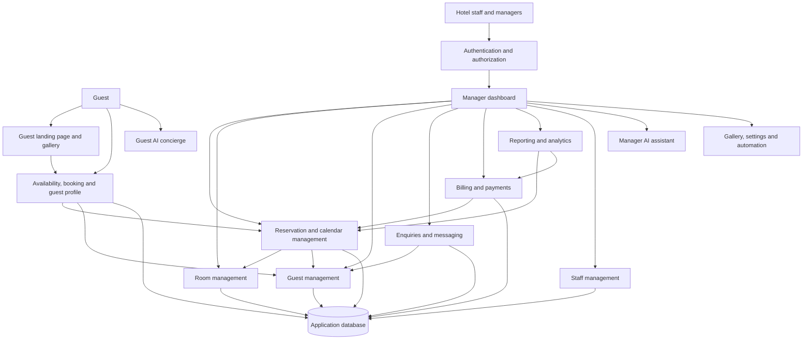
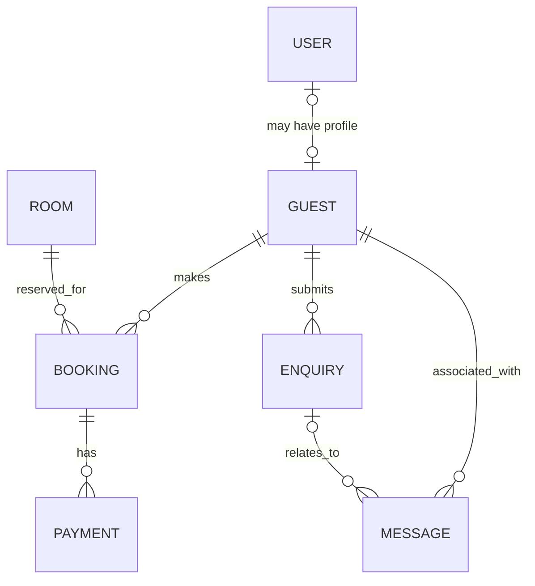

# Architecture Decision Record

**Project:** Villa Esmeralda Hotel Management System
**Date:** 2026-11-06
**Author:**

## Decision

Build a Laravel-based hotel management application with a public guest experience and an authenticated management experience. The final application will support property discovery, real availability and bookings, guest and hotel operations, payments, reporting, and assistance for guests and staff. The guest landing page and manager dashboard prototypes establish the intended user experience; other capabilities are described in the brief.

Delivery is incremental: the first milestone provides the guest-facing page and manager registration and login, with booking and the manager panel still mocked; the second introduces real bookings and production deployment. The final application extends beyond those milestones.

### Intended application flow

1. **Explore:** A guest visits the public landing page, switches between English and German if desired, and explores the property, gallery, accommodations, prices, amenities, surroundings, and contact information.
2. **Check availability and book:** The guest selects dates, guest count, and accommodation to check availability, then makes a reservation. The final application supports subsequent booking modifications and cancellations; the exact booking and confirmation process remains to be defined.
3. **Manage the stay:** Guests can manage their profiles, preferences, and booking history. The concierge provides answers and is intended to assist with guest-service tasks; the boundaries of its actions and integrations remain to be defined.
4. **Manage hotel operations:** An authenticated manager accesses the dashboard to review bookings, calendar availability, guest activity, enquiries, and payments. Staff manage reservations, rooms, guest information, and guest communications.
5. **Handle payments and oversight:** Staff manage payments, invoices, receipts, and reminders, while management uses reports and analytics for occupancy and revenue. Staff management and the AI assistant support hotel operations.
6. **Keep shared information consistent:** Guest bookings and manager reservation changes feed the reservation and availability views; guest, payment, and enquiry information supports the relevant management views and reporting. Detailed data ownership, workflow rules, and integrations remain to be defined.

## Context

The application is intended for guests exploring the property and eventually managing bookings, and for hotel staff and managers managing reservations, guests, payments, and other hotel operations. The existing prototypes illustrate the desired guest and manager experiences but do not constitute a working hotel management system.

## Chosen platforms

- Frontend: Laravel with Livewire for reactivity, plain CSS and Tailwind CSS for styling.
- Backend: Laravel 13 with Laravel Breeze for authentication.
- Database: SQLite locally; PostgreSQL in production.
- Deploy: undefined for production; a tunnel is planned for the first milestone. Laravel Cloud is a possible production option, not a confirmed choice.
- Testing: Pest and Playwright for end-to-end testing.

## Main components

These are the overall product components, not a commitment to implement all of them in the first milestone.

- **Authentication and authorization:** Register and authenticate managers and control access to the dashboard.
- **Guest landing page:** Present the property, rooms, prices, amenities, surroundings, contact details, and booking entry point.
- **Photo gallery:** Display property images with lightbox and image navigation.
- **Availability and guest booking:** Let guests check availability and make, modify, and cancel reservations.
- **Guest profiles:** Maintain guest profiles, preferences, and history, including guest self-management.
- **Manager dashboard:** Summarize bookings, guests, revenue, enquiries, and payments, and provide quick actions.
- **Reservation and calendar management:** Support manager booking creation, booking details, changes, cancellations, and availability views.
- **Room management:** Manage room availability, types, and prices.
- **Enquiries and messaging:** Present guest enquiries and support replies and messages to guests.
- **Billing and payments:** Handle invoices, payments, receipts, reminders, and financial reports.
- **Staff management:** Manage staff roles, schedules, and responsibilities.
- **Reporting and analytics:** Provide insights into occupancy, revenue, and other metrics.
- **AI concierge and assistant:** Assist guests and staff through chat and support platform tasks, subject to defined permissions and integrations.
- **Gallery, settings, and automation navigation:** Represent the corresponding manager areas shown as navigation placeholders in the prototype; their detailed scope remains undefined.
- **Language and navigation:** Provide English and German language selection and mobile navigation.

## Architectural decisions

- **Laravel full stack:** Chosen instead of an unspecified alternative application stack; the user has Laravel systems and hosting ready.
- **Breeze authentication:** Laravel Breeze's Blade stack supplies registration, login, and session management for the initial application, as requested by the user.
- **Livewire:** Chosen for frontend reactivity instead of an unspecified alternative frontend approach; no further rationale has been specified.
- **Plain CSS and Tailwind CSS:** Chosen instead of an unspecified alternative styling approach; the prototype styling must be retained for the first milestone.
- **SQLite locally and PostgreSQL in production:** Chosen instead of an unspecified alternative database setup; no further rationale has been specified.
- **Pest and Playwright:** Chosen for application testing and end-to-end testing, respectively, instead of unspecified alternative testing tools; no further rationale has been specified.

- **Accommodation inventory:** The Master Suite, Junior Suite, and Entire Villa have independent availability, as confirmed by the user.

### Component architecture

The diagram represents intended component dependencies, not a deployment topology. AI action permissions and external integrations remain undefined.

### Proposed application data model

This is a conceptual starting point for the final application, not an approved migration schema. Attribute types, constraints, account and staff roles, payment and message workflows, and retention policies require further decisions. The booking model below describes the single-accommodation selection shown in the prototype; support for multiple accommodations per booking remains undecided.

| Entity | Proposed attributes | Relationships |
| --- | --- | --- |
| User | ID, name, email, authentication credentials | May be associated with a guest profile; staff and manager authorization is to be defined. |
| Guest | ID, name, email, preferences | May be associated with a user; has bookings and enquiries. |
| Room | ID, name, accommodation type, nightly price, availability information | Has bookings; each of the three prototype accommodation options has independent availability. |
| Booking | ID, guest ID, room ID, check-in, check-out, guest count, amount, status | Belongs to a guest and a room; may have payments. |
| Payment | ID, booking ID, amount, method, date, status | Belongs to a booking. |
| Enquiry | ID, guest ID, message, received time, read status | Belongs to a guest; may have associated messages. |
| Message | ID, guest ID, enquiry ID where applicable, subject, body, sent time | Relates to a guest and optionally an enquiry; sender and delivery details are undecided. |

Invoices, staff scheduling, gallery content, analytics, automation, and AI data are not yet modeled in detail. Their entities and relationships depend on feature and integration decisions.

## Constraints

- Follow the guest and manager prototypes; retain their current styling for the first milestone.
- In milestone 1, guests can view the hotel page and managers can register and log in to view the mocked manager panel. Booking remains mocked; payments, guest messaging, reports, and AI integrations remain mocked or unimplemented.
- The initial scaffold uses Breeze's Blade stack and adapted prototype views; Livewire remains part of the planned stack but is deferred until a feature requires it.
- The first milestone intentionally demonstrates an authorization issue: anyone who can access the application through the tunnel can register and see the manager panel. The production authorization model remains undecided.
- Milestone 2 introduces real bookings, manager visibility of booked rooms, and production deployment.
- The existing prototype consists of static HTML, CSS, and JavaScript with simulated interactions; it is not an implemented Laravel application.
- Existing prototype end-to-end tests use Playwright with Chromium and a local static server.

## What is NOT in scope

- Real booking, payment, guest messaging, reporting, and AI integrations in milestone 1.
- A real manager panel in milestone 1; the panel remains mocked.
- The production hosting provider, domain, and authorization model are not yet decided.

## Planned future features
